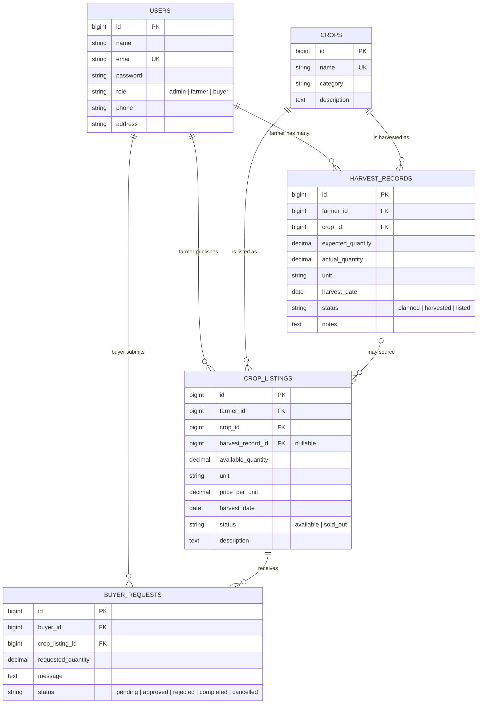

# Entity Relationship Diagram

Paste the block below into https://mermaid.live (or any Mermaid renderer), then export it
as `docs/erd.png` for the submission. You may also redraw it in dbdiagram.io or draw.io.

